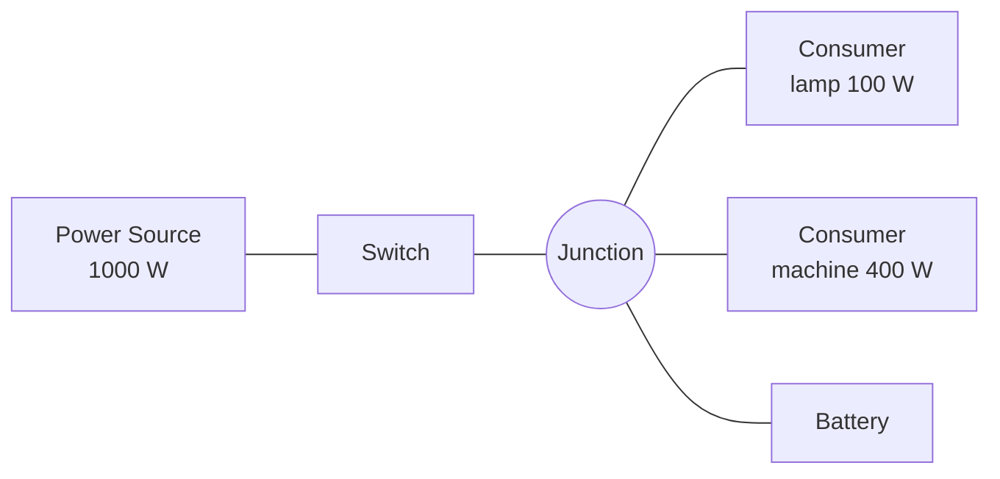

# How the grid works

## The model in one paragraph

The grid is an **abstract watt budget**, not a circuit simulation. Nodes are connected by wires. Every set of nodes that can reach each other through *conducting* nodes forms an **island**, called a *network*. Each network balances the power its sources and batteries can supply against the power its consumers request. There are no volts, amps or phases, which keeps the system fast, predictable and easy to tune for gameplay.

## Units

* Power is measured in **watts (W)**.
* Battery energy is measured in **watt-seconds (Ws)**. A 100 W load drains 6000 watt-seconds per minute.
* Time is measured in seconds.

## Nodes

Every electrical component is a *node*. A node is a scene component, so it has a position and can attach to a socket.

| Component | Role |
|---|---|
| [Junction](../components/junction.md) | Plain connection point. Conducts, does nothing else. |
| [Power Source](../components/source.md) | Offers up to *Max Output Watts* while running. |
| [Power Consumer](../components/consumer.md) | Requests *Requested Watts* while switched on. |
| [Switch](../components/switch.md) | Conducts only while closed. |
| [Breaker / Fuse](../components/protection.md) | Conducts while closed; opens when overloaded. |
| [Battery](../components/battery.md) | Stores energy, charges from surplus, discharges to cover a shortfall. |

A node that does not conduct (an open switch, a tripped breaker, a disabled node) is like a cut wire: nothing passes through it.

## Networks

* Wires are **bidirectional** and exist between two nodes.
* A network is the set of nodes connected through conducting nodes. Opening a switch can split a network in two; closing it merges them again.
* Each network has a **state**:

| State | Meaning |
|---|---|
| Idle | No supply and no demand. |
| Healthy | All demand is delivered. |
| Deficit | Supply exists but demand is larger. Some consumers get less (an overload). |
| Blackout | Consumers want power and nothing can supply it. |

The [grid subsystem](../api/grid-subsystem.md) event **On Network State Changed** fires when a network gets better or worse, including when a blackout ends because two networks merged.
