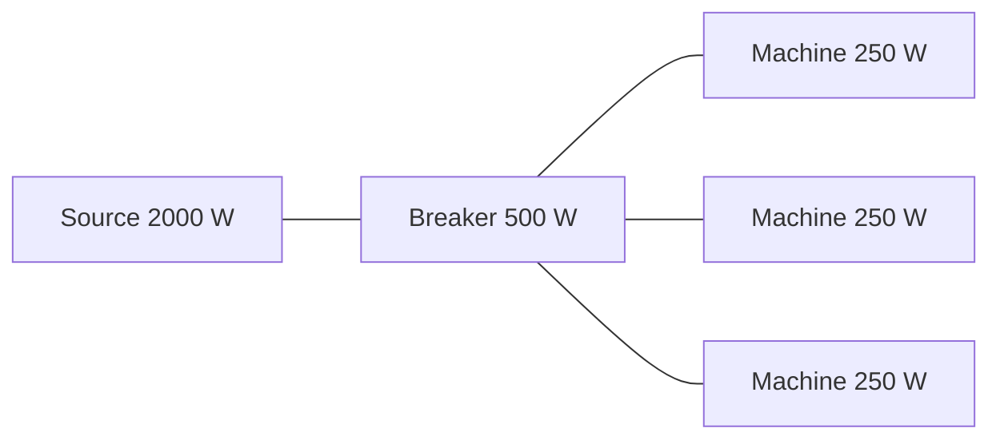

# Protection devices

A breaker or fuse measures the power flowing **through** it. For radial networks (a tree without loops) this is the load behind it minus any generation behind it. When the flow exceeds the rating, the device heats up on an **inverse-time curve**:

* *Heat* rises faster the bigger the overload. At exactly twice the rating it reaches 1 (and trips) after *Time To Trip At Double Load* seconds.
* Above *Instant Trip Ratio* times the rating it trips immediately, like a short circuit.
* Below the rating it cools down over *Cooling Time Seconds*.
* A tripped **breaker** can be closed again (**Close Breaker**), and can close itself after *Auto Reset Delay Seconds*.
* A blown **fuse** must be replaced (**Replace Fuse**).

Tripping removes the device from the network, which can overload the next device upstream. The grid resolves such **cascades** within one evaluation. The limit is *Max Cascade Iterations* in the [project settings](../components/settings.md).

Three machines of 250 W behind a 500 W breaker request 750 W. The flow is 1.5 times the rating, so the breaker heats up and, after enough time, trips. The machines behind it lose power until the breaker is closed again.

The device components are described on the [Breaker and Fuse](../components/protection.md) page.
